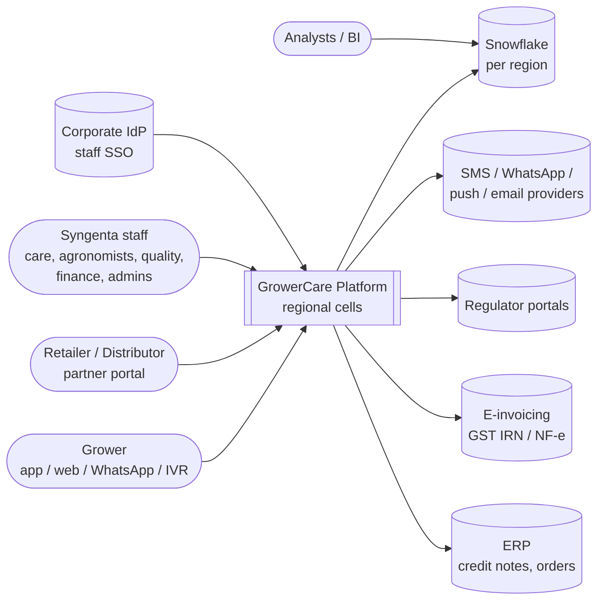
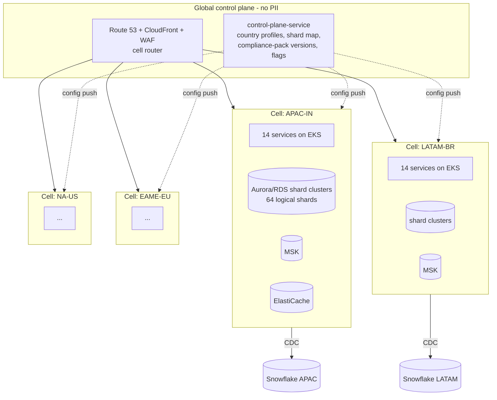
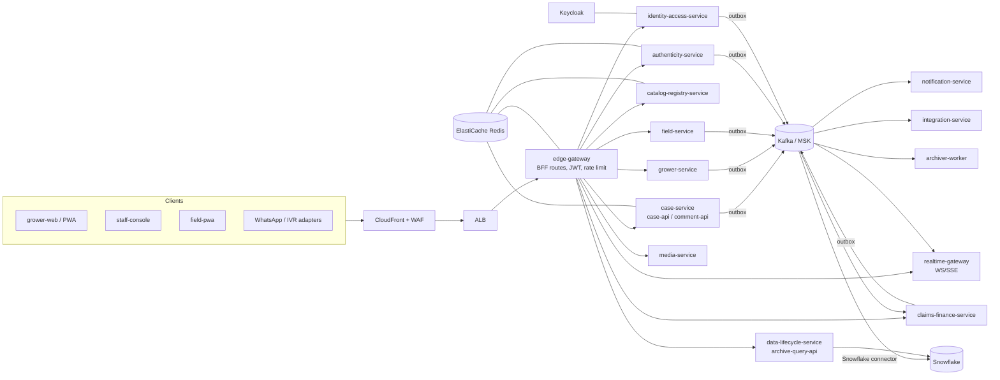

# GrowerCare — Solution Architecture Overview
*v1.0 · 2026-11-15 · Inputs: `docs/syngenta/01–05`. Decisions are recorded in `adr/`.*

## 1. Load this architecture is built for
| Dimension | Day 1 (worst case) | Growth target |
|---|---|---|
| Users | 10M per country × 20 countries = 200M | **1B** |
| Cases | 1 per user per day → 200M/day | ~1B/day |
| Comments | 5–10 per case → up to 2B/day | ~10B/day |
| CDC events | ~4B/day | ~20B/day |
| Peak writes | ~20K/s global (design) | ~100K/s |
| Peak reads | ~100K+/s global | ~500K/s |
| Hot data | ~5–10 TB per country | Per cell, bounded by the 90-day window |

## 2. Monolith or microservices?
**Decision: coarse-grained microservices (14), deployed in regional/country cells** (ADR-001).

| Factor | Monolith | Microservices | Verdict |
|---|---|---|---|
| Scaling profiles differ by 100× (scan reads vs comment writes vs Snowflake archive queries) | Scale everything together | Scale each service independently | Microservices |
| 20+ countries, many teams, frequent country-specific releases | One release train, merge contention | Independent deploys, CODEOWNERS per service | Microservices |
| Blast radius (a bad notification deploy must not stop case creation) | Shared process | Isolated processes + cells | Microservices |
| Operational cost & distributed-systems complexity | Lower | Higher (tracing, sagas, versioning) | Monolith |
| Data consistency | Local transactions | Outbox + sagas | Monolith |

**How we limit the microservice cost:**
- **14 services, not 50.** Each is a bounded context, internally a **hexagonal modular** app.
- **Database per service**, no shared tables.
- **Async first:** outbox + Kafka; at most **2 synchronous hops** in any request.
- **Shared libraries** (`policy-sdk`, `shard-routing`, `outbox`, `observability`) so cross-cutting concerns are written once.
- **Cells:** each cell runs the full set. A failure stays inside one cell.

## 3. System context

## 4. Cell model

- One **cell per large country** (IN, BR, US), one per region elsewhere (EU, AFRICA/ME, SEA).
- A user's cell is fixed by country of registration. The cell router resolves `country → cell`; at 1B users, `country + state group → cell` (see `05_SCALING_10M_TO_1B.md`).

## 5. Container view (inside one cell)

## 6. Service catalogue
| # | Service | Bounded context | Owns data | Sync API consumers | Publishes | Consumes | Phase |
|---|---|---|---|---|---|---|---|
| 1 | [edge-gateway](01_SERVICES/edge-gateway.md) | Edge | — (Redis buckets) | All clients | — | Grant invalidations | 1 |
| 2 | [identity-access-service](01_SERVICES/identity-access-service.md) | IAM & access governance | Users, grants, reviews | Gateway, services (grant lookups) | `iam.grant.*`, `iam.user.*` | `control.profile.*` | 1 |
| 3 | [grower-service](01_SERVICES/grower-service.md) | Grower & farm | Growers, plots, phone directory | Clients, case-service | `grower.*` | `iam.user.*` | 1 |
| 4 | [catalog-registry-service](01_SERVICES/catalog-registry-service.md) | Product & regulatory registry | Products, labels, batches | Case, field, authenticity | `catalog.*` | ERP batch feed | 1 |
| 5 | [case-service](01_SERVICES/case-service.md) | Field cases & comments | Cases, comments, activity (sharded) | Clients | `case.*`, `comment.*` | `field.visit.*`, `claims.*`, `media.*` | 1 |
| 6 | [field-service](01_SERVICES/field-service.md) | Field force | Schedules, visits, demos | Clients | `field.*` | `case.assigned` | 2 |
| 7 | [authenticity-service](01_SERVICES/authenticity-service.md) | Product authenticity | Serialized codes, scans | Clients (public) | `scan.*` | Packaging-line code feed | 2 |
| 8 | [claims-finance-service](01_SERVICES/claims-finance-service.md) | Claims & compensation | Claims, approvals | Clients | `claims.*` | `case.root_cause_set`, `integration.erp.*` | 2 |
| 9 | [notification-service](01_SERVICES/notification-service.md) | Messaging | Templates, deliveries, preferences | — (async) | `notification.delivered` | `case.*`, `comment.*`, `claims.*`… | 1 |
| 10 | [realtime-gateway](01_SERVICES/realtime-gateway.md) | Live updates | — (connection state) | Clients (WS/SSE) | — | `comment.*`, `case.*` | 2 |
| 11 | [media-service](01_SERVICES/media-service.md) | Evidence & files | Media metadata | Clients, case-service | `media.*` | S3 events | 2 |
| 12 | [integration-service](01_SERVICES/integration-service.md) | External systems (ACL) | Integration ledger | — | `integration.*` | `claims.*`, `case.incident.*` | 2 |
| 13 | [data-lifecycle-service](01_SERVICES/data-lifecycle-service.md) | Archive & analytics serving | Archive audit, stubs (via case-service) | Clients, dashboards | `archive.*` | CDC metadata | 2 |
| 14 | [control-plane-service](01_SERVICES/control-plane-service.md) | Global configuration | Country profiles, shard map, flags | All services (cached) | `control.*` | — | 1 |

**Phase 1 (7 services):** 1, 2, 3, 4, 5, 9, 14.

### Requirement ownership (BRD `docs/syngenta/02` → service)
| Requirement group | Owner |
|---|---|
| IAM-*, ACC-* | identity-access-service (enforced everywhere via `policy-sdk`) |
| GRW-1 | grower-service |
| GRW-2..6 | catalog-registry-service |
| CASE-*, CMT-*, STW-1 | case-service |
| STW-2 | integration-service (report submission) + case-service (workflow) |
| STW-3..5 | field-service (training records), case-service (container return) |
| FLD-* | field-service |
| SPR-* | field-service (spray marketplace module, phase 3) |
| AUTH-* | authenticity-service |
| FIN-* | claims-finance-service (+ integration-service for ERP/tax) |
| NOT-* | notification-service |
| DSH-*, DATA-* | data-lifecycle-service |
| CFG-*, ID-5, ID-6 | control-plane-service |
| ID-1..4, 7..12 | case-service (DB functions) |
| PRV-* | identity-access-service (consent, DSAR orchestration) + every data owner implements erasure |

## 7. Cross-cutting rules (every service)
1. **Authorization** through `policy-sdk` (policy enforcement point in every service; grants cached in Redis). No controller-level ad-hoc checks.
2. **Country/shard routing** through `shard-routing` (decode IDs; never accept a client-supplied shard).
3. **Events only via outbox** (same DB transaction); consumers are idempotent (inbox table keyed by event ID).
4. **Problem Details (RFC 9457)** errors; IDs as strings; cursor pagination.
5. **OpenTelemetry** traces with `country`, `cell` and `trace_id`; no PII in logs.
6. **Contracts first:** API and event changes start in `gc-contracts`.

## 8. Document map
| Doc | Topic |
|---|---|
| `01_SERVICES/*.md` | One per service: diagram, API, data, events, scaling, limitations, trade-offs |
| `02_DESIGN_PATTERNS.md` | Patterns and why |
| `03_TECH_STACK.md` | Backend/infra stack, Redis & Kafka rules |
| `04_REPOSITORIES.md` | Git repos & structure |
| `05_SCALING_10M_TO_1B.md` | Growth path and hard limits |
| `06_FRONTEND.md` | Frontend architecture |
| `07_DEPLOYMENT_AWS.md` | AWS, EKS, CI/CD |
| `adr/` | ADR-001 … ADR-012 |
