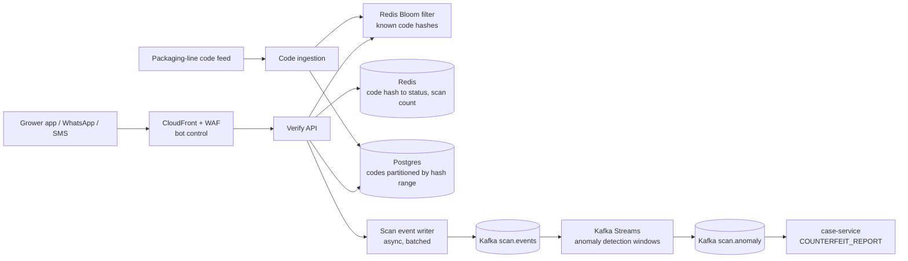
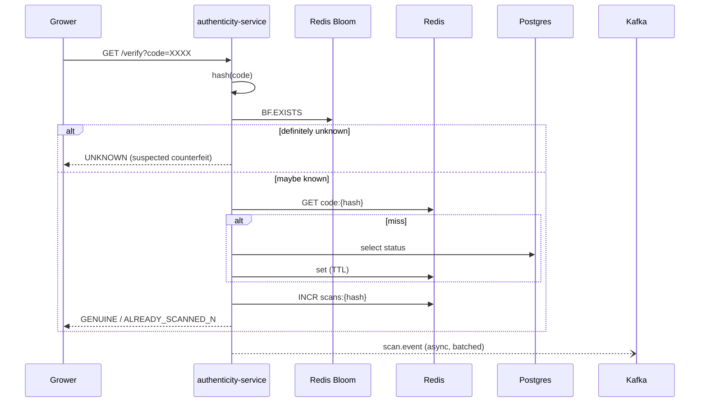

# authenticity-service
**Context:** Product authenticity & counterfeit detection · **Phase:** 2 · **Tech:** Spring Boot (reactive or virtual threads), Redis cluster, Postgres (partitioned), Kafka Streams

## Responsibilities
- Verify a scanned pack code (QR/serialized) → `GENUINE` / `ALREADY_SCANNED_N` / `UNKNOWN`, in the local language (AUTH-1).
- Ingest serialized codes from packaging lines: ≥ 96-bit random, **stored hashed** (AUTH-2).
- Record scan events; detect anomalies (geo-impossible re-scans, unknown-code clusters, spikes); open `COUNTERFEIT_REPORT` cases (AUTH-3).
- Optional loyalty points for genuine first scans, with anti-gaming limits (AUTH-4).

## Component diagram

## Key flow — verify

## API
`GET /verify?code=` (public, rate-limited per device/IP), `GET /admin/hotspots`, `POST /codes/batches` (internal ingestion).

## Data
- `serial_codes(code_hash PK, product_id, batch_id, status, first_scan_at)`: billions of rows, hash-partitioned.
- `scan_events`: append-only, monthly partitions, purged by partition drop after the Snowflake sync.

## Events
- **Publishes:** `scan.event`, `scan.anomaly.detected`.
- **Consumes:** `catalog.batch.recalled` (status → RECALLED).

## Scaling profile
- **Largest read path:** up to ~50% of peak traffic in season. Target p95 < 150 ms.
- The Bloom filter rejects most fake codes without touching Redis keys or the DB.
- Redis cluster sized for the active-season code set; the DB only sees cache misses.

## Limitations
- Static QR codes can be **copied** onto fake packs. Verification proves the code exists, not that the pack is genuine. Mitigations: first-scan semantics, geo/time anomaly detection, and (out of software scope) copy-detection patterns on packaging.
- A Bloom filter has false positives (never false negatives), so it's tuned to about 1% and followed by an exact lookup.

## Trade-offs
| Choice | Alternative | Why |
|---|---|---|
| Postgres + Redis | DynamoDB for code lookups | Keeps the approved stack; DynamoDB would remove partition management for billions of keys. Revisit at 1B users. |
| Async scan-event writes | Synchronous insert | Keeps verify latency low. A crash can lose < 1 s of scan events (acceptable for analytics, not for points). Points use a synchronous path. |
