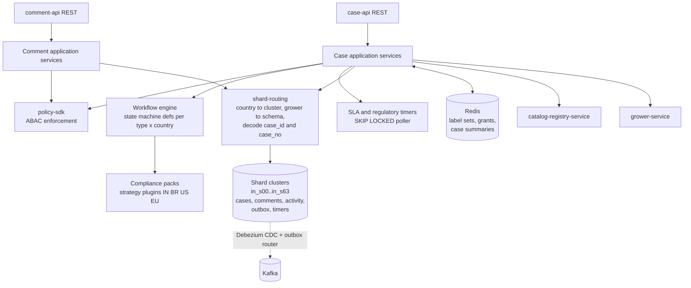
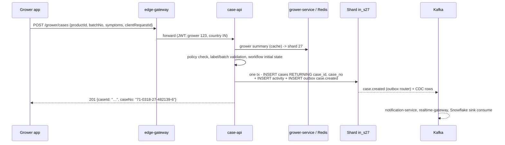
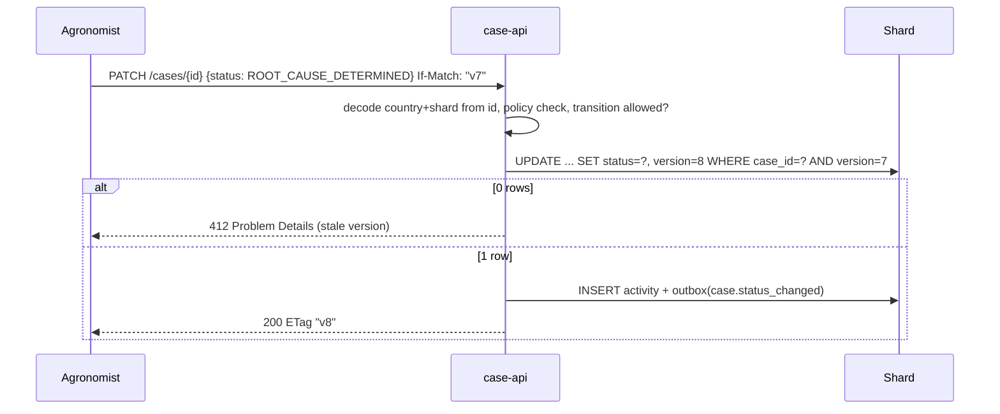

# case-service
**Context:** Field cases & comments (core) · **Phase:** 1 · **Tech:** Spring Boot (MVC + virtual threads), Postgres 64 shards per country, Hibernate schema multi-tenancy, Redis, Kafka (outbox)
**Deployments:** `case-api` (cases, workflow, activity) and `comment-api` (comments, read cursors, feeds). One codebase and one database owner, scaled separately.

## Responsibilities
- Case lifecycle for all case types (CASE-1..10) with a **versioned state machine per case type × country** (compliance packs add steps and fields).
- **DB-generated IDs** (`next_id()`, `next_case_no()`) per shard (ID-1..12).
- Assignment/routing rules (care queue, agronomist).
- SLA and regulatory clocks (durable timers, `SKIP LOCKED` poller).
- Comments (CMT-1..12): visibility levels, idempotent posting, keyset feeds.
- Activity/audit trail per case.
- Weekly partitions by `case_id`, plus carryover tables for the purge (doc 05 §6).

## Component diagram

## Key flow — create a case

## Key flow — status change with optimistic locking

## API (selected)
| Method | Path | Notes |
|---|---|---|
Implemented contracts: `docs/specs/case/02-case-lifecycle.md`, `03-comments-and-sharing.md`.

| Method | Path | Notes |
|---|---|---|
| POST | `/cases` | `Idempotency-Key` required; replay → 200 `Idempotent-Replayed` · **implemented** |
| GET | `/cases/{caseId}` · `/cases/by-no/{caseNo}` | Routed by decoding the ID; ETag · **implemented** |
| GET | `/cases?status&caseType&territoryId&assignedToMe&createdFrom&limit&cursor` | Hot window; parallel shard fan-out (D1); `createdFrom` older than 90 days → 501 until the archive · **implemented** |
| POST | `/cases/{caseId}/transitions` | `If-Match`; workflow edge + edge permission · **implemented** |
| PUT | `/cases/{caseId}/assignee` | `If-Match`; assignee validated via IAM by-id (D2) · **implemented** |
| GET/POST | `/cases/{caseId}/comments` | `clientMsgId` idempotency; visibility per role · **implemented** |
| PUT/DELETE | `/cases/{caseId}/shares/{partnerOrgId}` | Grower consent only · **implemented** |
| GET | `/cases/{caseId}/activity` | Notes for staff only · **implemented** |
| PUT | `/cases/{caseId}/read-cursor` | Unread tracking (later) |

## Data (per shard schema)
`cases`, `case_comments`, `case_activity` (range-partitioned weekly by `case_id`), `*_carryover`, `case_comment_stats`, `case_read_cursor`, `case_timers`, `archived_record_index`, `outbox`, `inbox`.

## Events
- **Publishes:** `case.created`, `case.assigned`, `case.status_changed`, `case.root_cause_set`, `case.incident.reportable`, `case.closed`, `comment.posted`, `case.sla.breach_risk`.
- **Consumes:** `field.visit.completed`, `claims.decision.made`, `media.scanned`, `catalog.product.withdrawn`, `grower.updated`.

**Implemented so far (SPEC-PLAT-04):**
- **Topic `case.case.events`** (key = caseId, published by Debezium from the shard outboxes). It carries:
  - case events: `case.created`, `case.routed`, `case.assigned`, `case.status_changed`, `case.shared`, `case.unshared`;
  - SLA events: `case.sla.warning`, `case.sla.breached`;
  - `comment.posted`.

  Contracts are in `gc-backend/contracts/events/`.
- **Consumer `case-service.iam-grant-cache`** reads `iam.grant.events`. On `iam.grant.created` / `iam.grant.revoked` it evicts the cached principal of `subject`. It uses the `msg.inbox` dedup, 3 retries and then `dlq.case-service.iam-grant-cache`.

## Scaling profile (largest cell, worst case)
| Metric | Value |
|---|---|
| Case writes | ~1,000/s design peak per country |
| Comment writes | ~4,600/s peak per country (comment-api scaled separately) |
| Pods | case-api ~20–40, comment-api ~40–80 per large country at peak |
| DB | 4 → 16 physical clusters per country; ~70 writes/s per logical shard |

## Limitations
- **Cross-shard queries** (e.g., "all open complaints for batch X in India") are scatter-gather over 64 shards. They're allowed only for internal batch jobs; UI lists of that kind come from Snowflake SERVING or OpenSearch (phase 3).
- **Schema migrations across 1,280 schemas** need the orchestrated `sharded-migration` process.
- **Workflow definition changes** must migrate in-flight cases. Definitions are versioned and cases pin their version.

## Trade-offs
| Choice | Alternative | Why |
|---|---|---|
| Comments inside case-service (separate deployment) | Separate comment microservice with its own DB | Comments need same-shard joins and atomic activity writes with the case. Costs a larger service codebase. |
| DB-generated IDs | ID service / app-generated | Instagram-proven, no extra service (ADR-002). Costs: ID only known after insert. |
| Partition-drop purge | Row-level deletes | Volume (doc 05 §6). Costs: carryover tables. |
| Own workflow engine (table-driven state machine) | Camunda/Temporal | Simple, shard-local transitions at very high volume. Temporal is reconsidered for long-running claim sagas only. |
