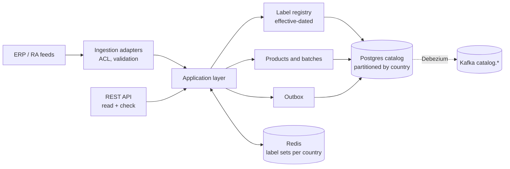
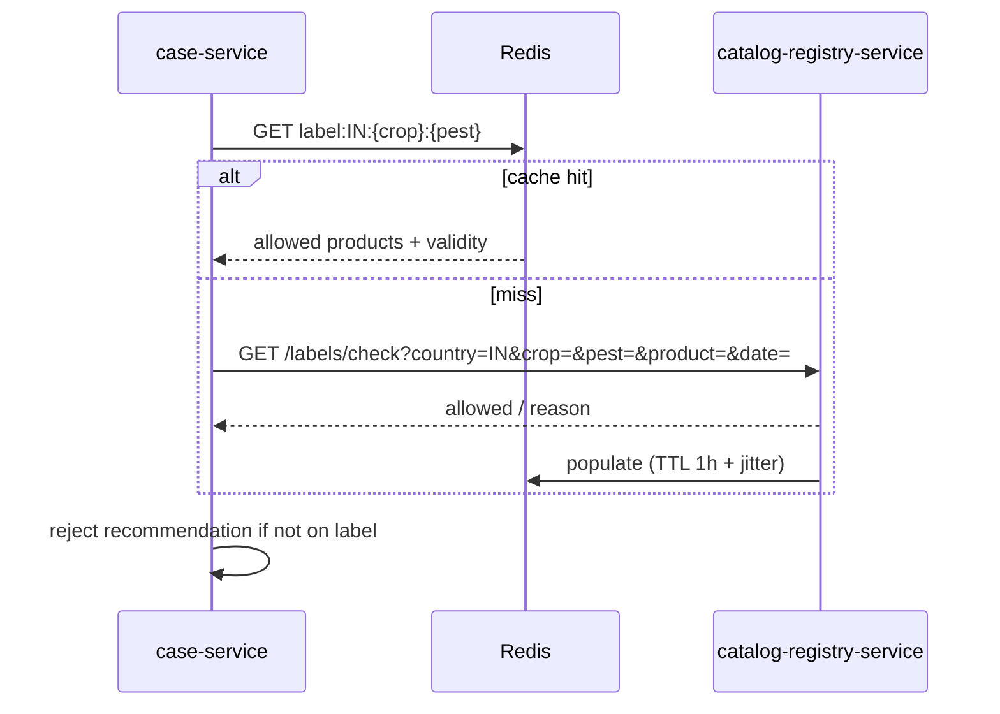

# catalog-registry-service
**Context:** Product & regulatory registry · **Phase:** 1 · **Tech:** Spring Boot, Postgres, Redis (read-through), ERP/regulatory feeds

## Responsibilities
- Product master (product, active ingredients, pack sizes, BU) synced from ERP.
- **Label registry per country**: allowed crop × pest × dose × pre-harvest interval, registration validity, banned/withdrawn flags, sell-off/use-up deadlines (GRW-3, GRW-6).
- **Label-compliance check API**: "may product P be recommended for crop C / pest X in country Y on date D?" (GRW-4).
- Batch/lot master (mfg date, expiry, plant) from ERP.
- Recall/withdrawal events.

## Component diagram

## Key flow — label-compliance check during a recommendation

## API (selected)
`GET /products`, `GET /products/{id}`, `GET /labels/check`, `GET /batches/{batchNo}`, `GET /countries/{cc}/registrations?updatedSince=`.

## Data
`products`, `active_ingredients`, `registrations` (effective-dated, per country), `label_uses`, `batches`, `withdrawals`, `outbox`. Small: millions of rows, not billions.

## Events
- **Publishes:** `catalog.registration.changed`, `catalog.product.withdrawn`, `catalog.batch.recalled`. Consumers evict caches; case-service flags affected open cases.
- **Consumes:** ERP batch feed (via integration-service).

## Scaling profile
- Read-heavy (every recommendation and complaint). ≥ 99% Redis hit rate expected.
- Writes are rare (regulatory changes).

## Limitations
- Label data quality depends on Regulatory Affairs inputs. A wrong label row = a compliance incident, so changes need **maker-checker** in the admin UI.
- Effective-dated rules need the *event date* (spray date), not "today", for complaint investigations.

## Trade-offs
| Choice | Alternative | Why |
|---|---|---|
| Own registry service | Read directly from RA systems | RA systems aren't built for 10K+ req/s or effective-dated queries |
| Cache full label sets per (country, crop) | Per-request DB query | Latency and cost. Accepts ≤ 1h staleness, mitigated by event-driven eviction. |
