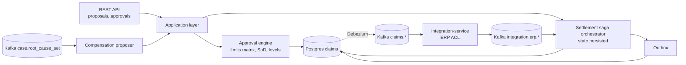
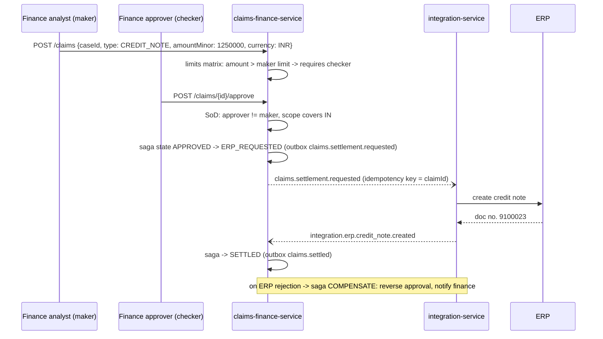

# claims-finance-service
**Context:** Claims, compensation & channel finance · **Phase:** 2 · **Tech:** Spring Boot, Postgres (not sharded; partitioned by country), Kafka, saga orchestration

## Responsibilities
- Compensation proposals from case outcomes: replacement, replant seed, retailer credit note, payout (FIN-1).
- **Maker–checker** with role/country **approval limits in local currency**, multi-level above thresholds, SoD (FIN-2, ACC-6, ACC-7).
- **Saga to ERP** via integration-service: create credit note / order / payment request, receive settlement, compensate on failure (FIN-3).
- Channel scheme/rebate claims and disputes (FIN-4).
- Money in minor units + ISO-4217; FX only for reporting (FIN-6).
- Finance dashboards feed (FIN-7, via Snowflake).

## Component diagram

## Key flow — approval and ERP settlement saga

## API (selected)
`POST /claims`, `GET /claims?country=&status=`, `POST /claims/{id}/approve`, `POST /claims/{id}/reject`, `GET /approval-limits`, `POST /schemes/claims` (phase 3).

## Data
`claims`, `claim_lines`, `approvals`, `approval_limits` (effective-dated per country/role), `saga_instances`, `outbox`, `inbox`.

## Events
- **Publishes:** `claims.proposed`, `claims.approved`, `claims.settlement.requested`, `claims.settled`, `claims.failed`.
- **Consumes:** `case.root_cause_set`, `integration.erp.*`, `iam.grant.revoked`.

## Scaling profile
Low volume (compensation applies to a small % of cases) but **high correctness**. Single partitioned Postgres per cell; no sharding needed.

## Limitations
- The ERP is the system of record. Our status can lag ERP by minutes; daily reconciliation compares saga states with ERP documents.
- Tax and legal invoice numbering are delegated to ERP / e-invoicing; this service never issues tax documents.

## Trade-offs
| Choice | Alternative | Why |
|---|---|---|
| Orchestrated saga (persisted state machine) | Choreography | Money flows need one place that knows the state and can compensate. Costs: a central orchestrator. |
| In-house saga | Temporal | Few step types today. Temporal is worth adopting if sagas multiply (payouts, rebates, barter). |
