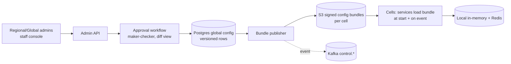
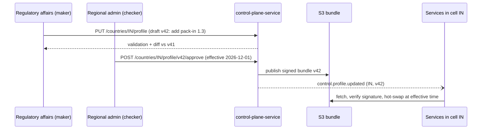

# control-plane-service
**Context:** Global configuration (no personal data) · **Phase:** 1 · **Tech:** Spring Boot, Postgres (global, multi-region read replicas), S3 config bundles, Kafka (global → cells via MirrorMaker 2 or bundle pull)

## Responsibilities
- **Country profiles** (CFG-1..3): locale, channels, case types enabled, workflow variants, regulatory clocks, tax/payment rails, privacy settings, seasons. Versioned, effective-dated, **two-person approval**.
- **Country registry** (ID-5): country index (6-bit), public CC slot, region, reference timezone, extra indices for growth.
- **Shard map** (ID-6): `(country, shard) → cluster endpoint`, versioned, used by `shard-routing` in every service.
- **Compliance-pack versions** enabled per country.
- **Feature flags** (per cell/country/role), maintenance banners.
- Workflow definitions per case type × country, validated against HQ guardrails.

## Component diagram

## Key flow — publish a country profile change

## API (selected)
`GET /countries/{cc}/profile?version=`, `PUT /countries/{cc}/profile`, `POST …/approve`, `GET /shard-map?country=`, `GET /flags?cell=`, `GET /registry/countries`.

## Data
`country_profiles` (versioned JSON + schema), `country_registry`, `shard_map`, `pack_versions`, `workflow_definitions`, `feature_flags`, `approvals`.

## Events
- **Publishes:** `control.profile.updated`, `control.shardmap.updated`, `control.flags.updated`.

## Scaling profile
Tiny write volume. Reads are served from **local caches in every service** (bundle loaded at start), so the control plane is **not on any request path**.

## Limitations
- A cell must run on its last good bundle if the global plane is down. Bundles are signed and cached locally; cells never block on the control plane.
- A bad config can affect many countries. Mitigations: effective dates, canary country, instant rollback to the previous version.

## Trade-offs
| Choice | Alternative | Why |
|---|---|---|
| Own control plane | AWS AppConfig / LaunchDarkly | Domain-specific validation (workflows, shard maps) and approval rules. AppConfig could deliver bundles underneath. |
| Signed bundles in S3 per cell | Live API calls | Cell independence and zero hot-path dependency. Costs: propagation takes seconds, not milliseconds. |
