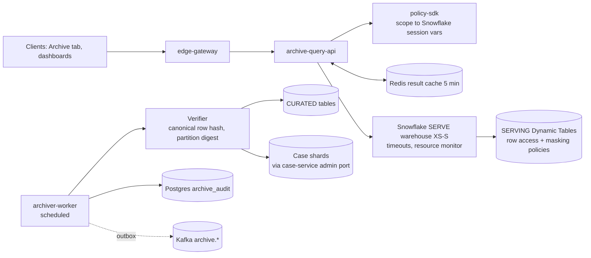
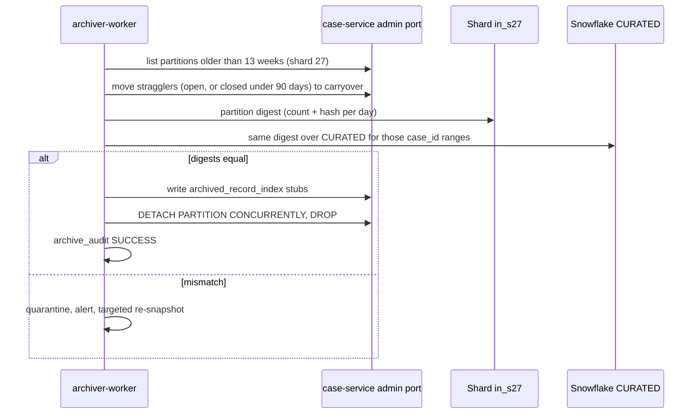

# data-lifecycle-service
**Context:** Archive & analytics serving · **Phase:** 2 · **Tech:** Spring Boot, Snowflake JDBC, Redis, Postgres (archive audit)
**Deployments:** `archive-query-api` (user-facing reads of data older than the hot window, plus dashboards) and `archiver-worker` (verify + purge).
**Design source:** `docs/syngenta/03_DATA_PLATFORM_DESIGN.md`, `05_CASE_COMMENTS_DESIGN.md §6`.

## Responsibilities
- **Archive query API** (DATA-8, CMT-12): UI filters with an older-than-3-months range → Snowflake SERVING; caller's ABAC scope passed to Snowflake row access policies.
- **Dashboard widgets** (DSH-1..4): per-country widget catalog, cached in Redis, served from SERVING.
- **Archiver** (DATA-4..7, 11):
  - weekly partition verification (count + hash digest vs Snowflake)
  - carryover move of stragglers
  - detach/drop orchestration via case-service's admin port
  - row-level purge-marker protocol for carryover rows
- **Reconciliation** (DATA-11): daily hot-window digests, weekly cold audit.
- **Restore** (DATA-9): audited rehydration of an archived case into its shard.

## Component diagram

## Key flow — weekly partition purge

## API (selected)
`GET /archive/cases?from=&to=&status=&type=&cursor=` (requires a date range + at least one filter), `GET /archive/cases/{caseId}`, `GET /archive/cases/{caseId}/comments`, `GET /dashboards/{widget}?scope=`, `POST /archive/cases/{caseId}/restore` (admin).

## Data
`archive_audit`, `reconciliation_runs`, `widget_catalog` (per country), Redis result cache. Snowflake objects are owned in `gc-data-platform`.

## Scaling profile
- archive-query-api: low RPS but expensive queries. Concurrency is capped per warehouse and per-user rate limits apply.
- Multi-cluster warehouse scales out at peak.
- archiver-worker: batch, parallel by shard.

## Limitations
- Snowflake latency (hundreds of ms to seconds) and **credit cost per query**, so the UI requires filters and pages are capped at 200 rows.
- Freshness of SERVING is ≤ 10 min. Ranges crossing the hot window go entirely to Snowflake (doc 03 §8), so recent rows can lag.

## Trade-offs
| Choice | Alternative | Why |
|---|---|---|
| Users query Snowflake through our API | Direct Snowflake access for users | ABAC, cost control and caching. Analysts get direct, policy-scoped roles. |
| Partition-drop purge | Row deletes | Volume (ADR-004). |
