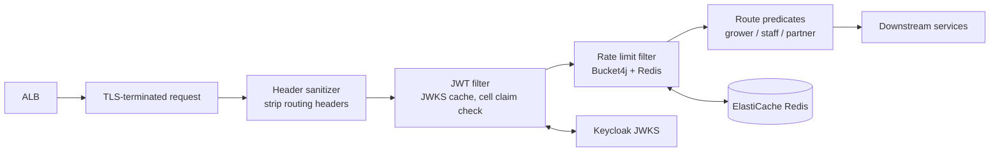
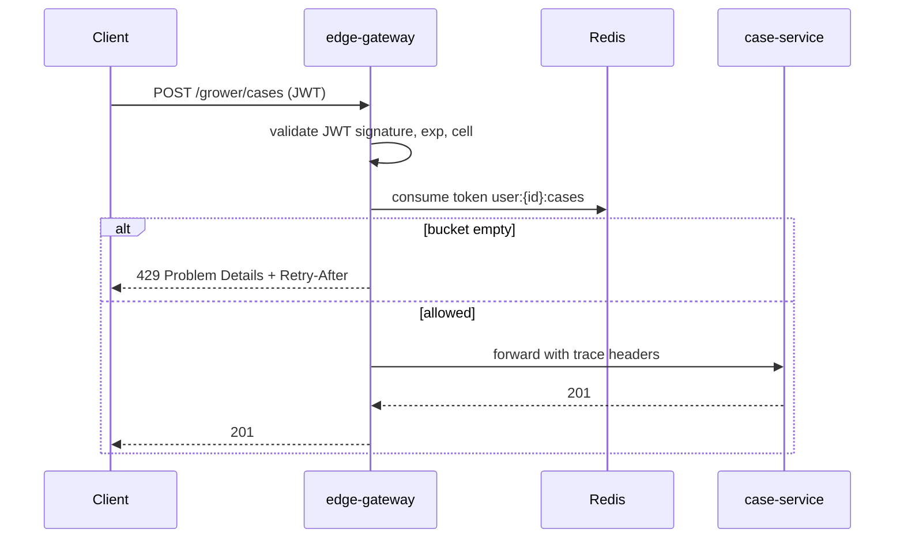

# edge-gateway
**Context:** Edge · **Phase:** 1 · **Tech:** Spring Cloud Gateway (reactive), Redis, Bucket4j

## Responsibilities
- Single entry point per cell behind ALB, exposing three **BFF route groups**: `/grower/**`, `/staff/**`, `/partner/**`.
- Validates JWTs (Keycloak JWKS, cached) and rejects tokens issued for another cell.
- Rate limiting per user, IP, device and partner org (token bucket in Redis); OTP endpoints get stricter limits.
- Request shaping: max body size, header allow-list, `X-Request-Id`/trace propagation, strips any client-supplied `X-Country`/`X-Shard` headers.
- Routes to services. **No business logic, no aggregation** (aggregation stays in services to avoid a "god gateway").

## Component diagram

## Key flow — rate-limited request

## API surface
Routes only; contracts live with each service in `gc-contracts`.

## Data
None persisted. Redis keys: `rl:{scope}:{id}` (TTL = bucket window).

## Scaling profile
- Stateless, CPU-bound (TLS already at ALB; JWT verification is the main cost).
- ~100K req/s global peak → ~20–40 pods in the largest cell (≈ 3–5K req/s per pod for reactive Netty).
- HPA on CPU + request rate.

## Limitations
- Redis is on the hot path for every rate-limited call. If Redis is down, the gateway **fails open** for authenticated staff and **fails closed** for OTP endpoints (fraud risk).
- Per-request JWKS lookups are avoided by caching. Key rotation needs overlap (Keycloak publishes old and new keys).

## Trade-offs
| Choice | Alternative | Why |
|---|---|---|
| Spring Cloud Gateway in EKS | AWS API Gateway | Request volume makes per-request API Gateway pricing expensive; we need custom Redis limits and a Java skill set. API Gateway would remove ops work. |
| Thin gateway, BFF by route groups | Separate BFF services per client | Fewer deployables; BFF-specific aggregation can move into a dedicated BFF later if the UI needs it |
