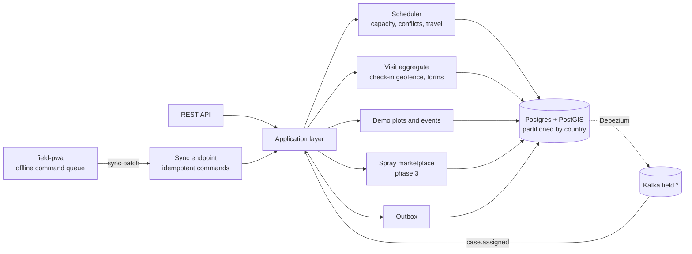
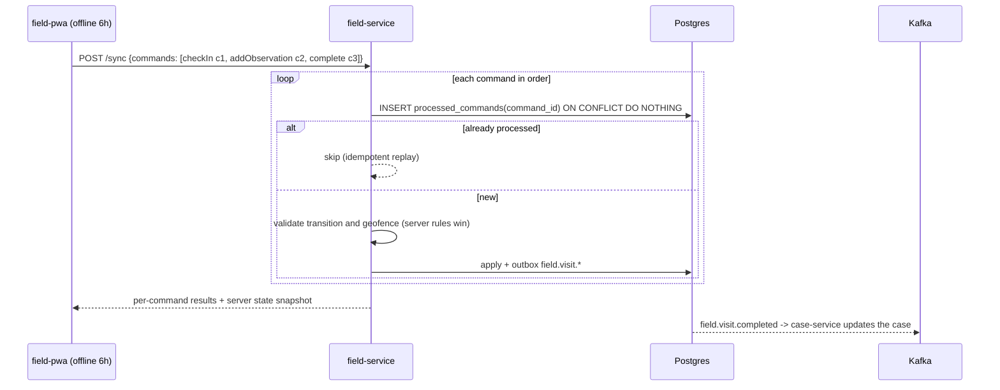

# field-service
**Context:** Field force · **Phase:** 2 (spray marketplace module: phase 3) · **Tech:** Spring Boot, Postgres + PostGIS (partitioned by country/territory), Redis, Kafka

## Responsibilities
- Agronomist and territory-manager profiles: skills (crops, BU), zones (polygons), calendars, leave.
- Visit scheduling for cases (CASE-5), day plans, check-in with geo-verification.
- **Offline sync API** for the field PWA (FLD-1): command log, idempotent replay, conflict rules.
- Demo plots & field events (FLD-2), retailer visits (FLD-3).
- Training/certification records (STW-3).
- Phase 3: spray-service marketplace (SPR-1..4): operator eligibility, capacity, weather windows, no double booking.

## Component diagram

## Key flow — offline visit sync

## API (selected)
`GET /me/day-plan`, `POST /visits`, `POST /visits/{id}/check-in`, `POST /sync`, `GET /agronomists/available?zone=&date=&skill=`, `POST /demos`, `POST /spray-jobs` (phase 3).

## Data
`agronomists`, `zones` (geometry), `calendars`, `visits`, `visit_forms`, `processed_commands`, `demos`, `spray_operators`, `spray_jobs`, `outbox`.

## Events
- **Publishes:** `field.visit.scheduled`, `field.visit.checked_in`, `field.visit.completed`, `field.demo.*`, `spray.job.*`.
- **Consumes:** `case.assigned`, `case.cancelled`, `iam.user.deactivated`.

## Scaling profile
- ~15K agronomists per large country: low request rate but bursty syncs (morning and evening).
- Sync payloads include photos by reference only (media-service).

## Limitations
- Offline conflicts: server rules win for state transitions. Field notes merge (append-only), so a few user-visible "your change was superseded" cases are unavoidable.
- Route optimisation is out of scope (an ordered list is shown). Real VRP optimisation would be a separate engine later.

## Trade-offs
| Choice | Alternative | Why |
|---|---|---|
| Command-log sync with idempotent IDs | CRDT/automerge document sync | Simpler, auditable and fits state machines. Less elegant for free-text co-editing, which isn't needed here. |
| Spray marketplace as a module here | Separate service | Shares scheduling/capacity logic. Split out if it becomes its own business line. |
