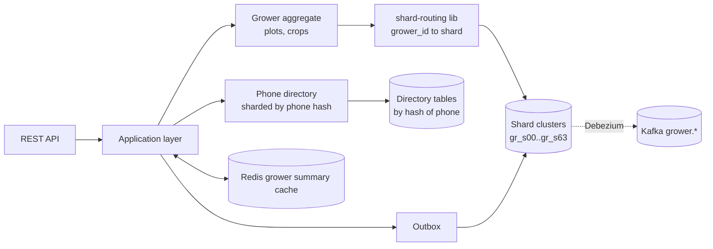
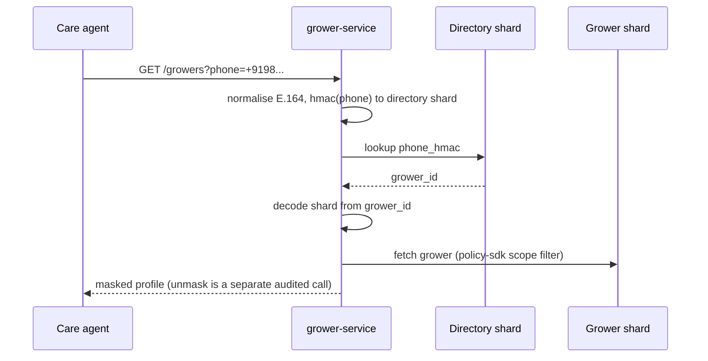

# grower-service
**Context:** Grower & farm · **Phase:** 1 · **Tech:** Spring Boot, Postgres (sharded, same 64-shard scheme as cases), PostGIS, Redis

## Responsibilities
- Grower profile: name, language, preferred retailer, consents (reference).
- Farms/plots: geo-polygon or point, crops and seasons, area.
- **Phone → grower directory**: the secondary index used for login lookups, IVR and care-agent search.
- Assisted onboarding by retailers/agronomists, with grower OTP consent.
- **Owns the grower → shard assignment** (`hash(grower_id) % 64`) that case-service uses.

## Component diagram

## Key flow — care agent finds a grower by phone

## API (selected)
`POST /growers`, `GET /growers/{id}`, `GET /growers?phone=`, `POST /growers/{id}/plots`, `PATCH /growers/{id}`, `POST /growers/{id}/consents`.

## Data
- `growers`, `plots` (PostGIS geometry), `grower_crops`, `outbox`. Sharded: 64 schemas per country; `grower_id` comes from the shard's `next_id()`, the same function shape as `case_id`.
- `phone_directory(phone_hmac PK, grower_id)`: sharded by `phone_hmac`. Phone numbers are stored as an **HMAC** (lookup) plus **encrypted** value (display), never plain text.

## Events
- **Publishes:** `grower.registered`, `grower.updated`, `grower.plot.changed`.
- **Consumes:** `iam.user.created` (link identity), `privacy.dsar.requested`.

## Scaling profile
- Writes: onboarding waves (campaigns).
- Reads: case creation (grower validation), served from a Redis cache.
- At 1B users, directory lookups ≈ login rate; covered by Redis plus the directory shards.

## Limitations
- **Secondary indexes in a sharded system** (search by phone, by name, by village) need their own sharded directory or a search engine. Only the phone directory is built in phase 1. Name/village search goes to OpenSearch in phase 3.
- A grower changing country = a new grower record in the new cell (data residency). This is an explicit migration flow, not an update.

## Trade-offs
| Choice | Alternative | Why |
|---|---|---|
| Same 64-shard scheme as cases | Single grower DB per country | 10M+ growers with plots and history per country, and colocated routing logic. Costs more schemas to operate. |
| HMAC + encrypted phone | Plain phone with unique index | PII protection, DPDP/GDPR breach impact. Costs key management (KMS) and blind-index rotation. |
