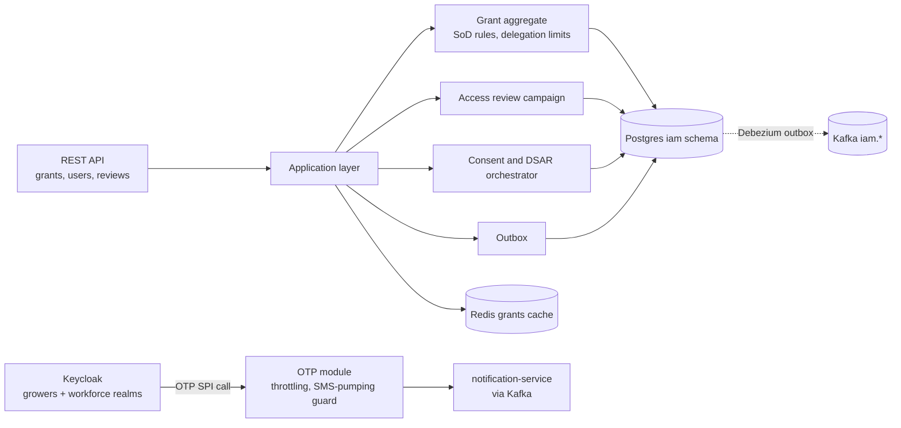
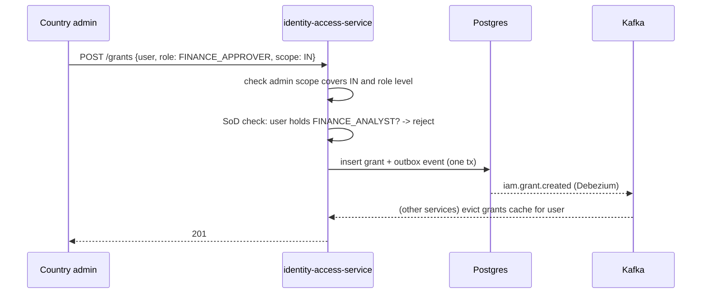

# identity-access-service
**Context:** Identity & access governance · **Phase:** 1 · **Tech:** Spring Boot, Keycloak (two realms: `growers`, `workforce`), Postgres, Redis

## Responsibilities
- **Authentication** is delegated to Keycloak:
  - Growers: mobile OTP via a custom Keycloak authenticator that calls this service's OTP API.
  - Staff: federated corporate SSO with MFA.
  - Partners: password + MFA.
- **Grants**: role + geo scope (region/country/territory) + BU scope + validity. Grants are the source of truth for ABAC (`ACC-1..12`).
- Delegated administration rules: who can grant what, and where.
- Segregation-of-duties checks on grant.
- Access monitoring: dormant accounts, privileged grants, unmask events, cross-border accesses.
- Quarterly access certification campaigns.
- Consent records and DSAR orchestration (fan-out to all data-owning services).
- Publishes grant changes. Every service's `policy-sdk` keeps a Redis-cached copy of the grants it needs.

## Component diagram

## Key flow — grant a role (SoD + delegation)

## API (selected)
| Method | Path | Notes |
|---|---|---|
| POST | `/otp/challenge`, `/otp/verify` | Called by Keycloak SPI only |
| GET | `/me` | Profile + effective grants (territories expanded to descendants) · **implemented** |
| POST | `/grants` | Delegation + SoD enforced (`GrantRules`); 201 + audit + `iam.grant.created` · **implemented** (maker-checker for privileged roles: later) |
| DELETE | `/grants/{id}?reason=` | Revoke (recorded, never deleted); returns the revoked grant · **implemented** |
| GET | `/users/{id}/grants` | Grants of a user in the admin's country scope · **implemented** |
| GET | `/internal/users/{sub}/principal` | Service-to-service (client credentials, `aud=gc-internal`, allow-listed clients) · **implemented** |
| GET | `/access-monitoring/*` | Dashboards (ACC-9) |
| POST | `/reviews/{id}/decisions` | Certification (ACC-10) |
| POST | `/privacy/dsar` | Starts the erasure/export saga |

## Data
`users`, `grants`, `grant_approvals`, `review_campaigns`, `review_items`, `consents`, `dsar_requests`, `unmask_log`, `outbox`. Not sharded: ~200M users per region fits a partitioned Postgres cluster. Large tables are partitioned by country.

## Events
- **Publishes:** `iam.user.created`, `iam.user.deactivated`, `iam.grant.created`, `iam.grant.revoked`, `privacy.dsar.requested`.
- **Consumes:** `control.profile.updated`, `privacy.dsar.completed.*`.

## Scaling profile
- Login peaks (morning in each country).
- OTP throughput is bounded by SMS provider limits, not CPU.
- Grant reads are served from Redis by `policy-sdk`, so this service isn't on the per-request path.

## Limitations
- Keycloak at 200M+ grower accounts needs careful tuning: database-backed user storage, Infinispan cache sizing, one Keycloak cluster per cell. Above ~100M users per cell, evaluate a lighter OTP token service for growers.
- Grant cache staleness: revocation reaches services via Kafka within seconds. Access tokens are short-lived (≤ 15 min) to bound exposure.

## Trade-offs
| Choice | Alternative | Why |
|---|---|---|
| Keycloak (self-hosted) | Amazon Cognito | Cognito's per-MAU pricing at hundreds of millions of MAU, plus limited custom OTP/SoD flows. Keycloak costs us operations work. (ADR-005) |
| ABAC grants in our DB + `policy-sdk` | External PDP (OPA/Cedar service) | Avoids a network hop per request; policies are versioned in the SDK. The SDK can later be backed by Cedar. |
