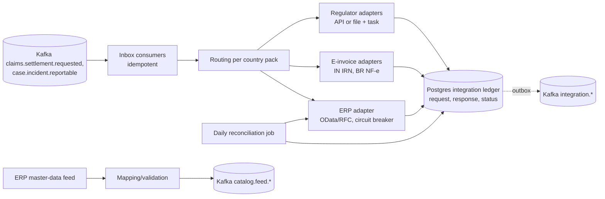
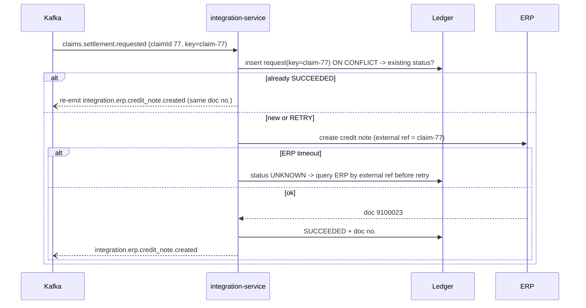

# integration-service
**Context:** External systems (anti-corruption layer) · **Phase:** 2 · **Tech:** Spring Boot, Spring Integration / Apache Camel routes, Postgres (integration ledger), Kafka, Resilience4j

## Responsibilities
- **ERP** (e.g., SAP S/4HANA): credit notes, replacement orders, settlement status, batch/product master feeds (FIN-3, GRW-2/5).
- **E-invoicing / tax**: GST IRN (IN), NF-e (BR) document references via providers (FIN-5).
- **Regulator portals**: adverse-incident report submission where an API exists; otherwise a generated file plus a manual-submission task (STW-2).
- Translates external models ↔ our domain events (**anti-corruption layer**), so ERP field names never leak into other services.
- Reliability: idempotency keys, retries with backoff, circuit breakers per endpoint, **daily reconciliation** with each system.

## Component diagram

## Key flow — idempotent ERP credit note

## Data
`integration_requests` (ledger, keyed by idempotency key), `reconciliation_runs`, `mapping_tables` (codes per country), `inbox`, `outbox`.

## Events
- **Consumes:** `claims.settlement.requested`, `case.incident.reportable`.
- **Publishes:** `integration.erp.*`, `integration.regulator.*`, `catalog.feed.*`.

## Scaling profile
Low to medium volume, **bounded by external systems' SLAs/quotas**. Bulkheads per external system so a slow ERP doesn't starve regulator submissions.

## Limitations
- External timeouts create an **unknown outcome**. We always query by external reference before retrying, so the external system must support lookup by our reference.
- Regulator portals often have no API, so a manual task in the staff console with an evidence upload is part of the design.

## Trade-offs
| Choice | Alternative | Why |
|---|---|---|
| One integration service with adapters | ERP calls inside each service | One ACL, one ledger, one place for credentials and reconciliation. Costs: one team owns many adapters. |
| Camel/Spring Integration | Commercial iPaaS (MuleSoft, Boomi) | Code-reviewed, testable, no per-transaction licence. An iPaaS speeds up many SaaS connectors. |
