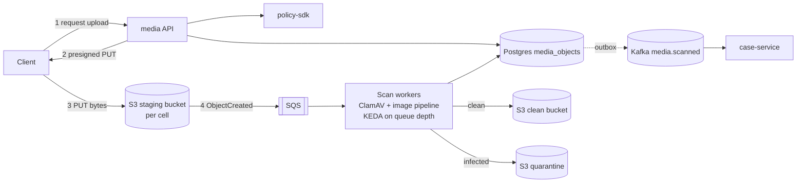
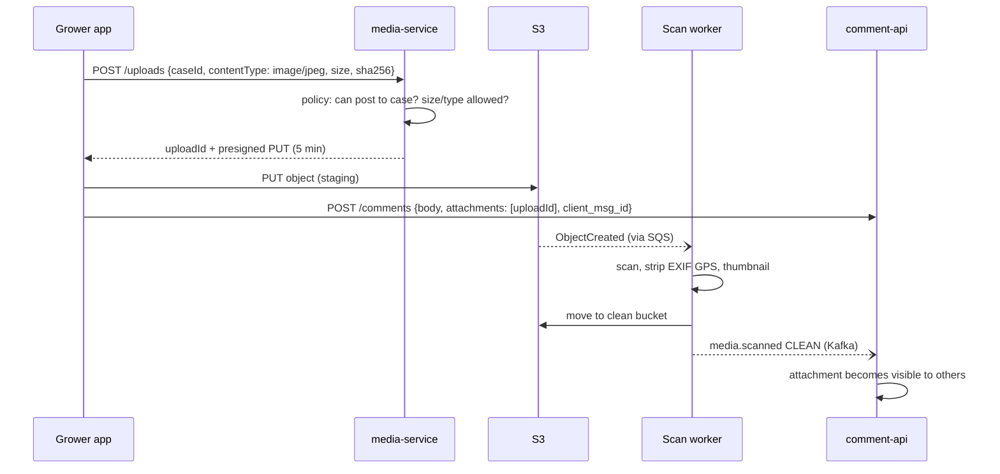

# media-service
**Context:** Evidence & files · **Phase:** 2 · **Tech:** Spring Boot, S3, S3 Event Notifications → SQS, ClamAV scanning workers on EKS, Postgres

## Responsibilities
- Issue **presigned S3 upload URLs** (direct client → S3; bytes never pass through our pods) with content-type, size (≤ 50 MB) and checksum constraints (CASE-3, CMT-10).
- **Async malware scan** and image processing (EXIF stripping of GPS where the policy requires it, thumbnails, compression).
- Quarantine infected files. Only `CLEAN` objects are viewable, through short-lived presigned GET URLs after a policy check.
- Lifecycle: S3 Intelligent-Tiering, then Glacier after the case is archived; legal-hold support.

## Component diagram

## Key flow — attach a photo to a comment

## Data
`media_objects(upload_id, owner_case_id, s3_key, status, sha256, size, content_type, created_at)`, partitioned monthly.

## Events
- **Publishes:** `media.scanned`, `media.quarantined`.
- **Consumes:** `archive.case.archived` (lifecycle transition), `privacy.dsar.requested`.

## Scaling profile
~1–3 TB/month per large cell. Scan workers scale on SQS depth. API load ≈ uploads (a fraction of comments).

## Limitations
- Scan latency (seconds to minutes) means the uploader sees their own file immediately, but others see it only after `CLEAN`.
- Large videos need multipart presigned uploads (phase 3).

## Trade-offs
| Choice | Alternative | Why |
|---|---|---|
| Direct-to-S3 presigned | Upload through API | Removes bandwidth load from pods; works with resumable uploads. Costs: async scan design. |
| ClamAV workers on EKS | Third-party scanning SaaS / GuardDuty Malware Protection for S3 | Control and cost at volume. GuardDuty for S3 is a strong managed option to evaluate. |
