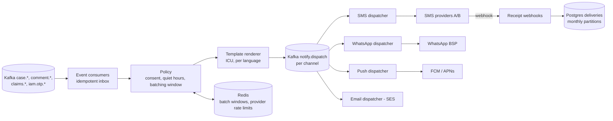
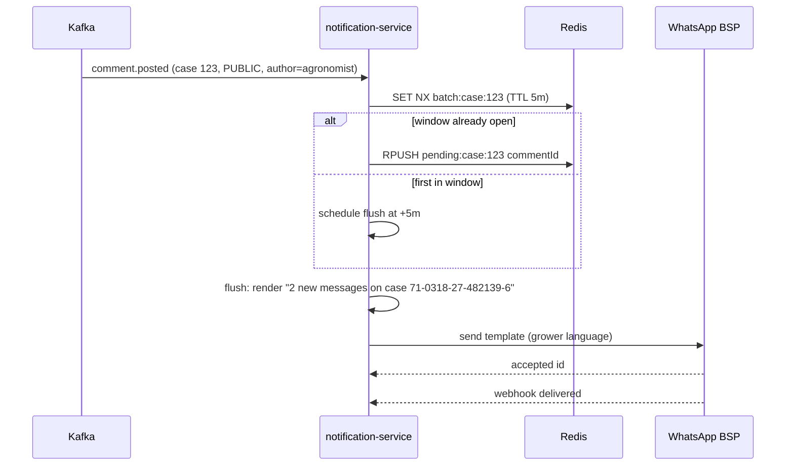

# notification-service
**Context:** Messaging · **Phase:** 1 (email/SMS/WhatsApp), 2 (preferences, batching, failover) · **Tech:** Spring Boot, Kafka consumers, Postgres (partitioned), Redis

## Responsibilities
- Turn domain events into messages per **country profile**: channels, templates, languages, quiet hours, consent (NOT-1..3).
- **Batching** per case (≤ 1 message per case per 5 min) to control SMS/WhatsApp cost at 2B comments/day.
- Provider routing & **failover** (e.g., WhatsApp → SMS), per-provider rate limits, retries with backoff, DLQ.
- Delivery receipts (provider webhooks, signature-verified).
- Regulatory/transactional messages bypass marketing opt-outs.

## Component diagram

## Key flow — comment notification with batching

## API
`GET/PUT /preferences` (grower/staff), `POST /webhooks/{provider}` (signed), admin template management (versioned, maker-checker).

## Data
`templates` (versioned per country/language), `preferences`, `deliveries` (monthly partitions, 90-day retention), `inbox`.

## Events
- **Consumes:** most domain events.
- **Publishes:** `notification.delivered`, `notification.failed`.

## Scaling profile
- Bursty: follows comment volume (up to ~4.6K/s per country), reduced by batching.
- Dispatchers scale on Kafka lag (KEDA).
- **The real limits are provider throughput and cost.**

## Limitations
- WhatsApp templates need provider pre-approval per language. New templates have lead time.
- Exactly-once delivery to phones isn't possible. At-least-once plus dedup by `(event_id, channel)` before send minimises duplicates.

## Trade-offs
| Choice | Alternative | Why |
|---|---|---|
| Own service + multiple providers | Single CPaaS (e.g., one provider for all) | Cost and resilience per country. Costs: more integrations. |
| Batching window | Notify per comment | ~5–10× fewer messages. Costs: up to 5 min delay (regulatory/urgent messages skip batching). |
