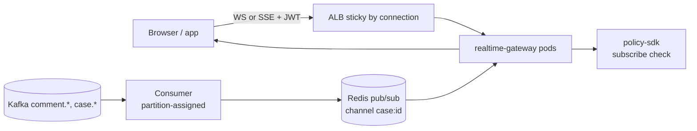
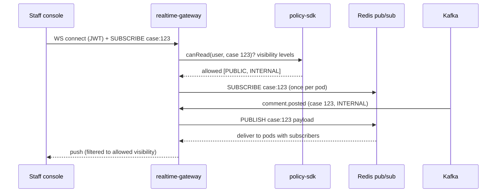

# realtime-gateway
**Context:** Live updates · **Phase:** 2 · **Tech:** Spring Boot WebFlux (WebSocket + SSE), Kafka consumer, Redis pub/sub

## Responsibilities
- Holds long-lived WebSocket/SSE connections for staff consoles and grower apps that have a case open (CMT-6).
- Subscribes clients to `case:{caseId}` channels **after an authorization check** (policy-sdk: can this user read this case and at which visibility level?).
- Fans out `comment.posted`, `case.status_changed` and `case.assigned` to subscribed connections, filtered by visibility.

## Component diagram

## Key flow — subscribe and receive

## Data
None persisted. Connection registry in memory; Redis pub/sub for cross-pod fan-out.

## Scaling profile
- Bounded by **concurrent connections**, not RPS. ~50–100K connections per pod (WebFlux, tuned file descriptors).
- Staff consoles and grower apps with a case open: estimate ~5% of daily active users concurrently → hundreds of thousands of connections per large cell.

## Limitations
- Redis pub/sub is fire-and-forget: a client briefly disconnected misses events. It **reconnects with `?after=<last comment_id>`**, and the REST feed fills the gap.
- Connection draining on deploys causes reconnect storms; mitigated with jittered client backoff and rolling deploys.

## Trade-offs
| Choice | Alternative | Why |
|---|---|---|
| Own gateway | AWS API Gateway WebSocket / AppSync | Per-message pricing at billions of messages; we need policy-sdk filtering. Costs: we run it. |
| Redis pub/sub fan-out | Each pod consumes all Kafka partitions | Keeps Kafka consumer groups small. Costs: a Redis dependency. |
| SSE for grower app | WebSocket everywhere | SSE works through more proxies and mobile networks; WebSocket for the staff console. |
