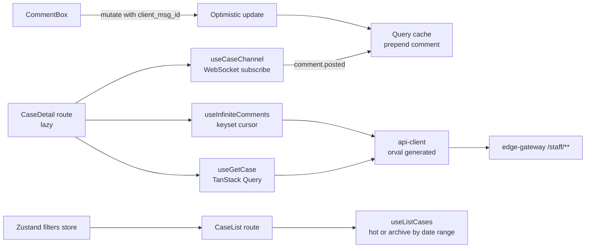

# Frontend Architecture

## 1. Applications
| App | Users | Type | Key needs |
|---|---|---|---|
| `grower-web` | Growers (+ retailers acting on behalf) | Responsive web + installable PWA | Low bandwidth, many languages, OTP login, case raise/track, comments, scan verify |
| `staff-console` | Care, agronomists (desk), quality, finance, admins, managers | SPA | Dense tables, filters, archive tab, dashboards per country, access monitoring, maker-checker |
| `field-pwa` | Agronomists, territory managers | Offline-first PWA | 72 h offline, command queue, photos, geo check-in |
| Partner portal | Retailers/distributors | Route group inside `staff-console` with a partner theme | Partner-scoped data only |

## 2. Stack
| Concern | Choice | Why |
|---|---|---|
| Framework | **React 18 + TypeScript + Vite** | Fast builds, standard ecosystem |
| Server state | **TanStack Query** with hooks **generated from OpenAPI by orval** (`packages/api-client`) | Caching, retries, pagination and optimistic updates; types always match the backend contract |
| Client/UI state | **Zustand** (small stores per feature: filters, UI prefs, offline queue status) | Minimal boilerplate. Server data never goes in Zustand. |
| Routing | React Router (data routers, lazy routes) | Route-level code splitting |
| UI kit | `packages/ui-kit`: Radix UI primitives + Tailwind CSS (shadcn-style, owned in-repo) | Accessible primitives, themable per partner/country |
| Tables | TanStack Table + TanStack Virtual | 10K-row virtualised lists, server-side filters |
| Forms | React Hook Form + Zod (schemas generated from OpenAPI where possible) | Performance and shared validation |
| i18n | FormatJS / react-intl (ICU messages), RTL support | 25+ languages, plurals, Arabic |
| Auth | oidc-client-ts (Authorization Code + PKCE) against Keycloak | Standard OIDC; tokens in memory, refresh via rotating refresh tokens |
| Authorization in UI | `packages/policy`: `<Can permission="case:assign" scope={…}>` driven by `/me` grants | Hides what the server will deny anyway (server is the authority) |
| Realtime | Native WebSocket (staff) / EventSource SSE (grower) with reconnect + `?after=` gap fill | Matches realtime-gateway |
| Charts | Apache ECharts | Rich dashboards, large datasets |
| Maps | MapLibre GL | Plots, zones, counterfeit hotspots; no per-load licence |
| Offline | Workbox (service worker) + Dexie (IndexedDB) command queue with UUIDv7 IDs | FLD-6 / ID-11 |
| Media | Client-side image compression before presigned upload | 2G/3G friendliness |

**Why not Redux Toolkit?** Almost all state here is server state (TanStack Query). The remaining UI state is small and feature-local, which Zustand handles with less code. RTK Query would duplicate TanStack Query. Redux only makes sense if a large cross-feature client state machine appears.

## 3. Feature-slice structure (each app)
```
src/
├─ app/             # providers (QueryClient, Intl, Auth), router, error boundaries
├─ features/
│  └─ cases/
│     ├─ api/       # thin wrappers over generated hooks (query keys, optimistic updates)
│     ├─ components/
│     ├─ routes/    # lazy-loaded pages
│     ├─ store.ts   # Zustand: filters, view prefs
│     ├─ i18n/      # messages
│     └─ __tests__/
├─ shared/          # app-specific shared components
└─ main.tsx
```

## 4. Data-flow diagram (staff console — case detail)


## 5. Performance & UX budgets
| Budget | Target |
|---|---|
| Grower initial JS (gzip) | ≤ 170 KB; route chunks ≤ 60 KB |
| LCP on 3G (Moto G-class) | ≤ 3.5 s |
| Staff console list of 10K rows | 60 fps scroll (virtualised) |
| Accessibility | WCAG 2.1 AA; axe checks in CI |

## 6. Testing
| Layer | Tooling | What |
|---|---|---|
| Unit/component | Vitest + React Testing Library | Components, hooks, Zustand stores |
| API mocking | **MSW** handlers generated from OpenAPI examples | Deterministic component and integration tests |
| E2E | **Playwright** (`gc-frontend/e2e`) against a staging cell | Per role: grower, care agent, agronomist, finance approver, country admin; cross-country isolation; offline sync |
| Visual | Storybook + Playwright screenshots for `ui-kit` | Regressions in shared components |
| Accessibility | axe-core in component tests + Playwright | |
| Performance | Lighthouse CI, bundle-size check | Budgets above |

## 7. Micro-frontends — not now
Module Federation would let teams deploy console modules independently. It costs shared-dependency versioning, runtime integration bugs and UX inconsistency. With one monorepo, route-level code splitting and CODEOWNERS per feature folder, we get most of the team independence. **Revisit if the staff console exceeds ~6 independent teams.**

## 8. Hosting
S3 (per app, per env) + CloudFront, with immutable hashed assets (1-year cache) and `index.html` no-cache. Country-specific config comes from the control-plane bundle at runtime, never baked into builds.
