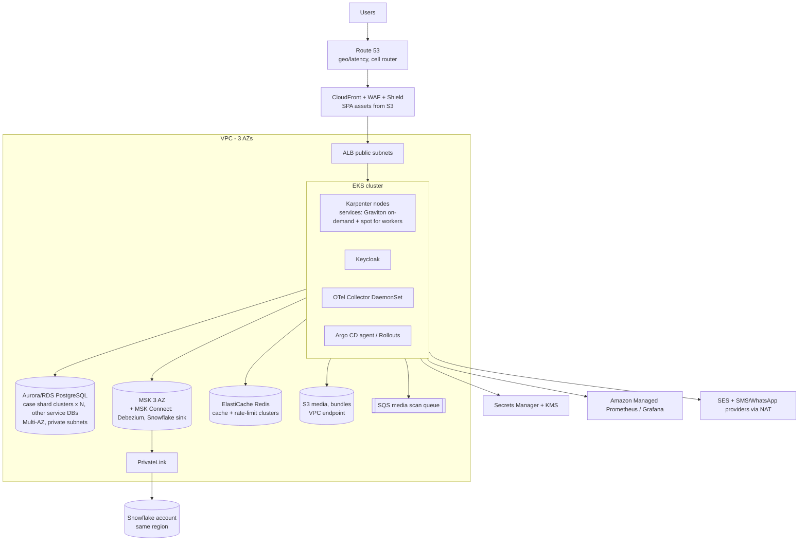
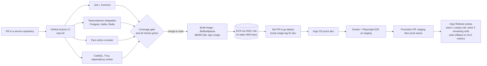

# Deployment — AWS, EKS, GitHub Actions

## 1. AWS organisation
| Level | Layout |
|---|---|
| AWS Organizations + Control Tower | OUs: `security`, `infrastructure`, `workloads-nonprod`, `workloads-prod` |
| Accounts | `log-archive`, `audit`, `shared-services` (ECR, CI roles), `global-control-plane`, and per cell/env: `prod-apac-in`, `prod-latam-br`, `prod-eame-eu`, `prod-na-us`, …, `staging-apac-in`, `dev` |
| Regions | Each cell in its in-country/in-region AWS region (e.g., `ap-south-1` Mumbai for IN, `sa-east-1` São Paulo for BR, `eu-central-1` Frankfurt for EU, `us-east-2` for US) |

## 2. One cell — deployment diagram

## 3. AWS services used
| Need | Service |
|---|---|
| Compute | **EKS** (managed control plane), **Karpenter**, Graviton instances, spot for stateless workers |
| Containers | **ECR** (shared-services account, replicated to cell regions), image scanning via **Inspector** |
| Databases | **Aurora PostgreSQL** for case/grower shard clusters (fast failover, storage auto-grow) and **RDS PostgreSQL** for smaller service DBs (ADR-006) |
| Streaming | **MSK** (provisioned, tiered storage) + **MSK Connect** (Debezium, Snowflake connector) + **Glue Schema Registry** |
| Cache | **ElastiCache** (Redis OSS / Valkey, cluster mode) |
| Storage | **S3** (+ Intelligent-Tiering, Glacier), **S3 Object Lock** for audit exports |
| Edge | **CloudFront**, **WAF** (bot control, rate rules), **Shield Advanced**, **Route 53** |
| Identity/secrets | IAM Roles for Service Accounts (IRSA / EKS Pod Identity), **Secrets Manager**, **KMS** (CMKs per cell) |
| Messaging | **SES** (email), **SQS** (media scan), external SMS/WhatsApp BSPs |
| Observability | **Amazon Managed Prometheus**, **Amazon Managed Grafana**, CloudWatch (AWS metrics/logs), OTel tracing backend |
| Security | **GuardDuty**, **Security Hub**, **Inspector**, **Config**, **CloudTrail** (org trail to log-archive) |
| Backup/DR | **AWS Backup** (cross-account vault), Aurora PITR, cross-region snapshot copy **within the same jurisdiction** |
| Connectivity | VPC endpoints, **PrivateLink** to Snowflake, NAT gateways per AZ |

## 4. Kubernetes conventions
- Namespaces per service; resource requests/limits; PodDisruptionBudgets; topology spread across AZs.
- **Kyverno** policies: no `latest` tags, signed images only (cosign verify), non-root, read-only root FS, required labels (`service`, `team`, `cell`).
- NetworkPolicies default-deny; services allowed by label.
- **KEDA** for Kafka-lag and SQS-depth scaling; HPA for APIs.
- Secrets via **External Secrets Operator** from Secrets Manager (never in Git).
- Probes: Spring Boot Actuator `/actuator/health/liveness` and `/readiness`; readiness includes DB and Kafka checks, liveness doesn't.

## 5. CI/CD pipeline

| Stage | Detail |
|---|---|
| CI (GitHub Actions) | Reusable workflows in a `.github` org repo; Maven repository cache + `-pl/-am` affected-module builds; Testcontainers on `ubuntu-latest` runners (or self-hosted runners on EKS via Actions Runner Controller for speed) |
| Supply chain | SBOM (Syft) attached to image, cosign keyless signing (GitHub OIDC), provenance (SLSA level 3 target) |
| AWS access | GitHub OIDC → IAM role per repo/environment; **no long-lived keys** |
| CD | **GitOps with Argo CD**: GitHub Actions never runs `kubectl` against prod; it only opens PRs in `gc-deploy` |
| Progressive delivery | Argo Rollouts canary 5% → 25% → 100% with Prometheus analysis (error rate, p95 latency); cell waves: `staging` → canary cell (smallest prod cell) → all cells |
| DB migrations | Run as a pre-sync Kubernetes Job per service; sharded migrations via the orchestrator with per-shard progress and a halt-on-error; always expand/contract |
| Infra | `gc-infra`: plan on PR (posted as comment), apply after approval via GitHub Environments with required reviewers |
| Frontend | Build once, deploy the same artifact per env to S3 + CloudFront invalidation; runtime config from control plane |

## 6. Environments
| Env | Purpose | Data |
|---|---|---|
| `dev` | Integration of main branch | Synthetic |
| `staging-<cell>` | Prod-like (same topology, smaller) for E2E, load and chaos | Synthetic, prod-like volumes |
| `prod-<cell>` | Production | Real; PII stays in-region |
| Ephemeral preview (optional) | Per-PR namespace for frontend + mocked backends | Synthetic |

## 7. DR & resilience
- Multi-AZ everything within a cell. **RPO ≤ 5 min / RTO ≤ 2 h** per cell (from the BRD).
- Cross-region DR only to a region allowed by that country's data-residency rules. Where there's only one allowed region, DR = multi-AZ + backups + restore drills.
- Quarterly game days: AZ loss, Aurora writer failover (verify Debezium slot recovery), MSK broker loss, Redis failover, Keycloak outage.
